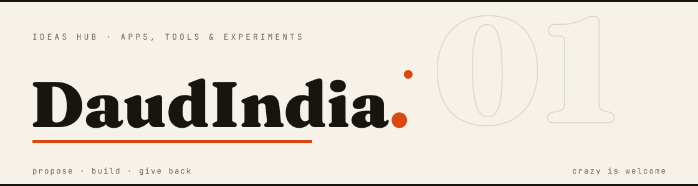

# DaudIndia

Open-source ideas from Indian runners, for Indian runners.

DaudIndia is the ideas hub of IndianRunners: open-source apps, tools and experiments for runners in India. Everything here starts as an idea, clearly marked, until someone builds it.

## How ideas move

| Stage | What it means |
| --- | --- |
| **Proposed** | A problem, who it helps and how it could be built. Anyone can propose one. |
| **In progress** | Someone started building. The work links out to its own repo. |
| **Built** | Shipped and open source. |

## First project: the running glossary

The repo's first project is live: [the running glossary](GLOSSARY.md), 129 running terms from training jargon to ultra slang, in plain language. It is open for contributions, so add the terms you had to learn the hard way.

## Second project: Finisher Studio

[Finisher Studio](https://indianrunners.github.io/DaudIndia/finisher-studio/) is a free finisher card and keepsake bib generator. Type your own name, event, distance and finish time, and it draws two downloadable PNG keepsakes right in your browser - no sign-up, no server, and your details never leave the page. Keepsakes are original designs, clearly marked unofficial: they are mementos, not official race certificates or proof of result. The whole tool is one file at [finisher-studio/index.html](finisher-studio/index.html).

## The ideas

Ideas live in the [issue tracker](https://github.com/IndianRunners/DaudIndia/issues) so each one gets its own discussion. First ideas landing soon.

## Propose an idea

Open an issue with three short paragraphs:

1. **The problem** - what runners keep struggling with, and who it affects.
2. **The idea** - the app, tool or experiment you wish existed.
3. **How it could work** - rough notes: what it could be built with, existing projects it could reuse, what the smallest first version looks like.

Crazy is welcome. Unbuildable is fine too - mark it as a dream and it might still spark something.
